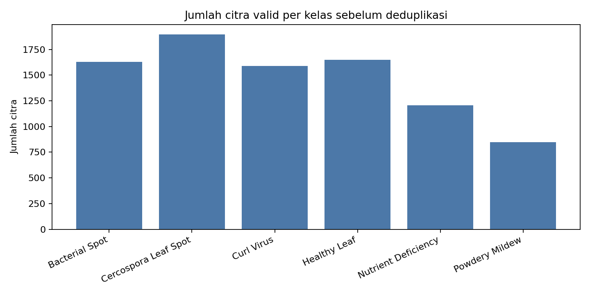
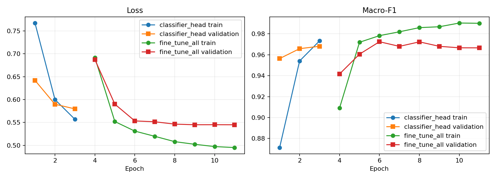
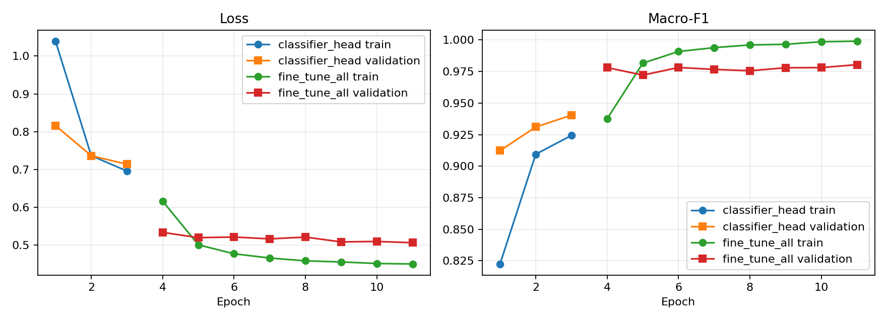
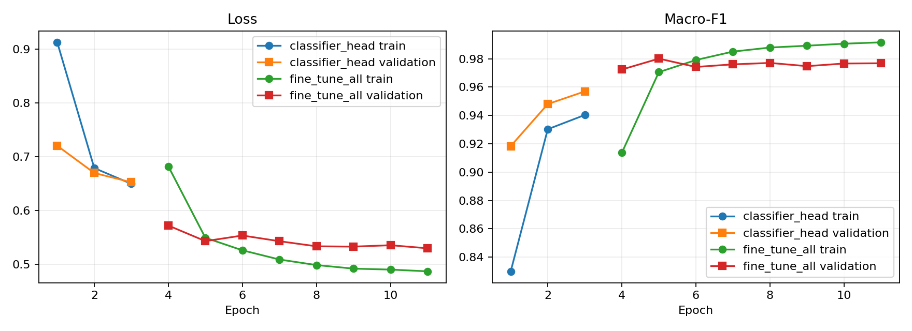

# Klasifikasi Kondisi Daun Cabai Menggunakan CNN


Proyek akademik ini membandingkan MobileNetV3-Small, MobileNetV3-Small + CBAM, ResNet-50, dan EfficientNet-B0 untuk mengklasifikasikan citra ke enam kondisi daun cabai. **`Klasifikasi_Daun_Cabai.ipynb` adalah satu-satunya workflow canonical** untuk pemuatan data, pelatihan, evaluasi, visualisasi, dan penyajian hasil.

## Daftar Isi

- [Ringkasan penelitian](#ringkasan-penelitian)
- [Unduhan dataset dan artefak](#unduhan-dataset-dan-artefak)
- [Dataset, audit, dan pembagian data](#dataset-audit-dan-pembagian-data)
- [Metodologi dan arsitektur](#metodologi-dan-arsitektur)
- [Hasil eksperimen](#hasil-eksperimen)
- [Struktur repository](#struktur-repository)
- [Instalasi dari awal di Windows dan VS Code](#instalasi-dari-awal-di-windows-dan-vs-code)
- [Penempatan dataset dan checkpoint](#penempatan-dataset-dan-checkpoint)
- [Melihat hasil, evaluasi, dan training ulang](#melihat-hasil-evaluasi-dan-training-ulang)
- [Kebutuhan komputasi](#kebutuhan-komputasi)
- [Keterbatasan penelitian](#keterbatasan-penelitian)
- [Troubleshooting](#troubleshooting)
- [Kontributor](#kontributor)
- [Referensi](#referensi)

## Ringkasan penelitian

Penelitian menggunakan transfer learning berbobot ImageNet untuk membandingkan kinerja klasifikasi enam label kondisi daun cabai. Metrik utama dan dasar pemilihan checkpoint adalah **Macro-F1 pada validation set**. Test set belum digunakan untuk memilih model dan tetap disimpan untuk evaluasi akhir.

Notebook memuat output eksperimen tersimpan. Membuka notebook dan membaca output yang sudah ada tidak memerlukan training, dataset lokal, atau checkpoint. Evaluasi ulang checkpoint memerlukan citra hasil ekstraksi dan file bobot yang dijelaskan di bawah.

## Unduhan dataset dan artefak

<p>
  <a href="https://drive.google.com/drive/folders/1E44RAI1peuiq79lwv0a4Xbv-ymzEkyRH?usp=sharing"></a>
  <a href="https://data.mendeley.com/datasets/tm3v4zmh7c/1"></a>
</p>

> **Status Google Drive (pemeriksaan langsung ChatGPT):** ZIP dataset dan 18 file eksperimen untuk tiga model dasar tersedia dengan struktur yang sesuai. Checksum ZIP di Drive dan artefak CBAM **belum diverifikasi**. SHA-256 di bawah merujuk pada ZIP lokal yang diaudit; path penempatan file ada di bagian [Penempatan dataset dan checkpoint](#penempatan-dataset-dan-checkpoint).

Sumber dataset asli adalah [Chilli Leaf Disease Image Dataset for Classification and Early Diagnosis in Agriculture](https://data.mendeley.com/datasets/tm3v4zmh7c/1), DOI [10.17632/tm3v4zmh7c.1](https://doi.org/10.17632/tm3v4zmh7c.1), oleh Radoanul Arifen dan S. M. Meriyan Islam. Record Mendeley mencantumkan lisensi [CC BY 4.0](https://creativecommons.org/licenses/by/4.0/); berikan atribusi kepada pembuat dataset dan cantumkan perubahan jika dataset diadaptasi.

- Tautan backup eksternal lain: **Belum tersedia; tautan backup belum diberikan.**
- Arsip lokal yang diaudit: `data/Chilli Leaf Disease Image Dataset for Classificati.zip`.
- SHA-256 arsip ZIP lokal yang dicatat dan dicocokkan dengan file lokal: `7b95cbbf3b725d3fc7f7315438efb374c5ce58e226473975a28e5079f7a08c4d`.

## Dataset, audit, dan pembagian data

Metadata Mendeley menyebut 8.814 citra. Audit pada ZIP lokal yang digunakan proyek menemukan **8.817 citra valid**. Lima kelas memiliki jumlah yang sama dengan metadata Mendeley; kelas Powdery Mildew berisi 846 citra pada ZIP lokal, sementara record Mendeley mencatat 843. Selisih tiga citra ini tidak dihapus atau dijelaskan dengan dugaan. Manifest proyek dibuat untuk arsip lokal yang checksum-nya tercantum di atas.

| Temuan audit lokal | Hasil |
|---|---:|
| Citra valid dan dapat dibuka | 8.817; tidak ada citra rusak yang tercatat |
| Format dan mode | 2.793 JPEG/RGB; 6.024 PNG/RGBA |
| Resolusi | 1.968 resolusi berbeda; 2.028 citra berukuran 1000 x 1000 |
| Duplikat persis yang dikecualikan | 881 |
| Citra unik yang masuk pembagian data | 7.936 |
| Kandidat near-duplicate dHash, jarak Hamming <= 4 | 2.712 pasangan; 642 grup mencakup 1.877 citra |

Notebook mengubah citra ke RGB dan ukuran 224 x 224. Nama folder berikut adalah label yang digunakan manifest, bukan label singkat pada sebagian metadata publik.

| Kelas pada manifest | Valid di ZIP | Unik | Train | Validation | Test | Duplikat dikecualikan |
|---|---:|---:|---:|---:|---:|---:|
| Bacterial Spot | 1.629 | 1.280 | 896 | 192 | 192 | 349 |
| Cercospora Leaf Spot | 1.898 | 1.683 | 1.178 | 253 | 252 | 215 |
| Curl Virus | 1.590 | 1.582 | 1.108 | 237 | 237 | 8 |
| Healthy Leaf | 1.647 | 1.481 | 1.037 | 222 | 222 | 166 |
| Nutrient Deficiency | 1.207 | 1.067 | 747 | 160 | 160 | 140 |
| Powdery Mildew | 846 | 843 | 590 | 127 | 126 | 3 |
| **Total** | **8.817** | **7.936** | **5.556** | **1.191** | **1.189** | **881** |

Jumlah per kelas dan subset di atas sama pada manifest seed 42, 43, dan 44. Path citra pada tiap seed tetap disimpan di `data/processed/split_manifest.csv`.



Exact duplicate dan near-duplicate groups yang tercatat tidak melintasi train, validation, dan test pada manifest yang diverifikasi. dHash hanya heuristik kemiripan visual; dataset tidak menyimpan identitas daun atau tanaman, sehingga pembagian group-aware tidak dapat menjamin tidak ada korelasi biologis yang tersisa.

## Metodologi dan arsitektur

Rancangan eksperimen mengikuti PPT Progress I ketika berbeda dari laporan lama. Ringkasannya:

- Transfer learning ImageNet, input RGB 224 x 224, dan normalisasi dari bobot TorchVision.
- Group-aware split 70:15:15 dengan manifest seed 42, 43, dan 44; eksperimen perbandingan yang tersimpan memakai seed 42.
- Training dua tahap: 3 epoch tahap awal pada learning rate 0,001, lalu fine-tuning seluruh model selama 8 epoch pada learning rate 0,0001. Untuk MobileNetV3-Small + CBAM, tahap awal melatih CBAM dan classifier sementara feature extractor serta BatchNorm backbone dibekukan; tahap kedua melatih seluruh model.
- Batch size 32, AdamW, weight decay 0,0001, label smoothing 0,1, dan cosine annealing.
- Augmentasi hanya pada train: horizontal flip 0,5, rotasi +/-15 derajat, brightness 0,2, contrast 0,2. Class weight dihitung dari train.
- Macro-F1 validation menjadi metrik utama dan penentu checkpoint terbaik. Test set tidak dipakai dalam hasil di README ini.

| Arsitektur | Bobot pralatih | Catatan |
|---|---|---|
| MobileNetV3-Small | `IMAGENET1K_V1` | Baseline |
| MobileNetV3-Small + CBAM | `IMAGENET1K_V1` | Satu CBAM channel lalu spatial setelah `features`, sebelum global average pooling; SE bawaan dipertahankan |
| ResNet-50 | `IMAGENET1K_V2` | Pembanding |
| EfficientNet-B0 | `IMAGENET1K_V1` | Pembanding |

## Hasil eksperimen

Hasil berikut berasal dari artefak seed 42 yang tersimpan. Metrik dihitung pada **validation set**; bukan hasil test. Nilai loss adalah validation loss pada epoch checkpoint Macro-F1 terbaik.

| Model | Accuracy | Macro-Precision | Macro-Recall | Macro-F1 | Validation loss |
|---|---:|---:|---:|---:|---:|
| MobileNetV3-Small | 0,9706 | 0,9724 | 0,9738 | 0,9725 | 0,5534 |
| MobileNetV3-Small + CBAM | 0,9706 | 0,9725 | 0,9749 | 0,9727 | 0,5431 |
| ResNet-50 | 0,9790 | 0,9800 | 0,9820 | 0,9804 | 0,5066 |
| EfficientNet-B0 | 0,9790 | 0,9792 | 0,9814 | 0,9801 | 0,5426 |

| Model | Parameter | Ukuran checkpoint terbaik | Durasi training | Median inferensi per citra |
|---|---:|---:|---:|---:|
| MobileNetV3-Small | 1.524.006 | 5,94 MiB | 40,3 menit | 0,189 ms |
| MobileNetV3-Small + CBAM | 1.565.576 | 6,10 MiB | 46,7 menit | 0,204 ms |
| ResNet-50 | 23.520.326 | 90,02 MiB | 35,9 menit | 1,861 ms |
| EfficientNet-B0 | 4.015.234 | 15,60 MiB | 32,7 menit | 0,793 ms |

Training dan timing inferensi dilakukan pada NVIDIA GeForce RTX 4060 Laptop GPU. Keempat model memakai protokol yang sama: 5 putaran warm-up pada 5 batch validasi pertama (hingga 25 forward batch), lalu median dari 3 pass penuh atas tensor validasi yang sudah ditransformasi. Pengukuran mencakup transfer CPU ke GPU, forward pass, dan argmax; tidak mencakup pembacaan file, transformasi citra, pemuatan checkpoint, atau penyalinan prediksi kembali ke CPU. Nilai ms/citra membagi median waktu pass penuh dengan jumlah citra validasi.

**Riwayat training dan grafik aktual:**

### MobileNetV3-Small



### MobileNetV3-Small + CBAM

Checkpoint terbaik dipilih pada fine-tuning epoch 8 (epoch global 11), dengan validation Macro-F1 0,9727. Dibanding baseline, Macro-F1 bertambah 0,0002 (sekitar 0,023 poin persentase), accuracy tetap 0,9706, dan validation loss turun 0,0103. CBAM menambah 41.570 parameter (2,73%), ukuran checkpoint bertambah sekitar 0,16 MiB, median inferensi bertambah 0,015 ms/citra, dan durasi training bertambah 6,5 menit. Selisih satu seed ini kecil dan bersifat deskriptif.

Kurva training CBAM ditampilkan langsung pada output bagian perbandingan di notebook dan tersimpan lokal sebagai `data/processed/runs/mobilenet_v3_small_cbam_seed_42_20261115_152555_521465/training_curves.png`.

### ResNet-50



### EfficientNet-B0



> Checkpoint berbobot besar tidak disimpan di Git. Grafik, konfigurasi, dan training history tercatat di repository; checkpoint untuk evaluasi harus ditempatkan pada path yang disebutkan di bawah.

## Struktur repository

```text
Deep-Learning-Cabai/
|-- AGENTS.md
|-- Klasifikasi_Daun_Cabai.ipynb
|-- README.md
|-- requirements.txt
|-- docs/
|   |-- DEEP LEARNING.md
|   |-- DEEP LEARNING PPT.pdf
|   `-- DL-01-DL-02-decisions.md
`-- data/
    `-- processed/
        |-- audit.json
        |-- class_distribution.png
        |-- exact_duplicates.csv
        |-- near_duplicate_candidates.csv
        |-- split_manifest.csv
        `-- runs/
            |-- mobilenet_v3_small_seed_42/
            |-- mobilenet_v3_small_cbam_seed_42_20261115_152555_521465/
            |-- resnet50_seed_42_20261115_101121_042498/
            `-- efficientnet_b0_seed_42_20261115_104718_619397/
```


## Instalasi dari awal di Windows dan VS Code

### 1. Siapkan Python, VS Code, dan repository

1. Pasang **Python 3.10.2 64-bit** dari [halaman rilis resmi Python 3.10.2](https://www.python.org/downloads/release/python-3102/). Versi ini sesuai environment proyek yang terverifikasi; setelah instalasi, buka PowerShell baru dan periksa `py -3.10 --version`.
2. Pasang [Visual Studio Code](https://code.visualstudio.com/Download).
3. Di Extensions VS Code, pasang extension resmi [Python](https://marketplace.visualstudio.com/items?itemName=ms-python.python) dan [Jupyter](https://marketplace.visualstudio.com/items?itemName=ms-toolsai.jupyter).
4. Ambil repository dengan salah satu cara:
   - **Git:** opsi ini memerlukan Git. Buka PowerShell pada lokasi kerja, lalu jalankan:

     ```powershell
     git clone https://github.com/Mingoming/Deep-Learning-Cabai.git
     cd Deep-Learning-Cabai
     code .
     ```

   - **Tanpa Git:** buka [halaman repository](https://github.com/Mingoming/Deep-Learning-Cabai), pilih **Code > Download ZIP**, ekstrak ZIP repository, lalu di VS Code pilih **File > Open Folder** dan buka folder hasil ekstraksi yang berisi `Klasifikasi_Daun_Cabai.ipynb` dan `requirements.txt`. GitHub dapat menamai folder hasil ekstraksi `Deep-Learning-Cabai-main`.

Selalu buka **folder repository**, bukan hanya file notebook. Notebook memakai `Path.cwd()` sebagai root dan mengharapkan folder `data/` relatif terhadap root itu.

### 2. Buat virtual environment dan pasang dependency

Buka terminal PowerShell di VS Code pada root repository. Tidak perlu mengaktifkan environment melalui skrip PowerShell; gunakan interpreter `.venv` langsung:

```powershell
py -3.10 -m venv .venv
.\.venv\Scripts\python.exe -m pip install --upgrade pip
.\.venv\Scripts\python.exe -m pip install -r requirements.txt
```

`requirements.txt` mematok PyTorch 2.10.0, TorchVision 0.25.0, dan pustaka notebook proyek. Environment yang telah diverifikasi memakai Python 3.10.2, PyTorch 2.10.0+cu128, TorchVision 0.25.0+cu128, dan CUDA 12.8. Wheel Windows CPython 3.10 tersedia pada [indeks resmi PyTorch](https://download.pytorch.org/whl/cu128/torch/) dan [TorchVision](https://download.pytorch.org/whl/cu128/torchvision/).

Python 3.10.2 adalah environment referensi proyek. Halaman Python resmi mencatat versi tersebut telah berakhir masa dukungan keamanan; versi ini dicantumkan untuk mereproduksi environment eksperimen.

Periksa instalasi dari terminal:

```powershell
.\.venv\Scripts\python.exe -c "import torch, torchvision; print(torch.__version__, torchvision.__version__, torch.version.cuda); print('CUDA tersedia:', torch.cuda.is_available()); print('Perangkat:', torch.cuda.get_device_name(0) if torch.cuda.is_available() else 'CPU')"
```

**Pilih perangkat komputasi:**

- **GPU NVIDIA:** `requirements.txt` memasang build CUDA 12.8 yang digunakan pada eksperimen. Gunakan kernel `.venv` dan pastikan pemeriksaan di atas menampilkan `CUDA tersedia: True` serta nama GPU.
- **CPU:** notebook otomatis memilih CPU ketika `torch.cuda.is_available()` bernilai `False`; GPU tidak wajib untuk menjalankan jalur ini. Instalasi tetap memakai `requirements.txt` yang sama. Training CPU belum diukur dan dapat jauh lebih lama.

### 3. Pilih kernel notebook

1. Buka `Klasifikasi_Daun_Cabai.ipynb` di VS Code.
2. Klik **Select Kernel** di kanan atas.
3. Pilih **Python Environments**, lalu interpreter dari `.venv` pada folder repository.
4. Jika kernel tidak muncul, jalankan **Python: Select Interpreter** dari Command Palette, pilih `.venv\Scripts\python.exe`, lalu buka kembali pemilih kernel.

Dependency `ipykernel` sudah ada di `requirements.txt`. Notebook menyimpan nama kernel lama `dl-cabai`; pada clone baru, pilih interpreter `.venv` yang benar, meskipun label lama pada metadata notebook berbeda.

## Penempatan dataset dan checkpoint

### Dataset

1. Unduh arsip dari tombol Drive atau pilih **Download All** pada record Mendeley. Unggahan Drive belum terverifikasi; bila mengambil arsip Mendeley, pastikan SHA-256 cocok dengan nilai audit sebelum memakai manifest proyek.
2. Simpan ZIP di root folder `data/` dengan nama `Chilli Leaf Disease Image Dataset for Classificati.zip`. Buat `data/` jika belum ada. Periksa hash di PowerShell:

   ```powershell
   Get-FileHash -Algorithm SHA256 ".\data\Chilli Leaf Disease Image Dataset for Classificati.zip"
   ```

   Nilai yang diharapkan: `7b95cbbf3b725d3fc7f7315438efb374c5ce58e226473975a28e5079f7a08c4d`. Jika berbeda, hentikan penggunaan manifest ini dan minta tim memastikan pasangan arsip/manifest; jangan mengganti manifest atau label sendiri.
3. Gunakan **Extract All** Windows ke folder sementara. ZIP luar berisi empat ZIP kelas di dalamnya dan dua folder kelas langsung. Pastikan tersedia ruang untuk arsip dan hasil ekstraksi. Buat `data/extracted/`, ekstrak isi file citra dari ZIP kelas ke folder target di kolom kanan, lalu salin isi dua folder langsung ke folder target. Jangan sisakan satu folder akar tambahan di antara `data/extracted/` dan folder kelas.

| Nama di arsip sumber | Folder target yang harus ada |
|---|---|
| `Bacterial_Spot.zip` | `data/extracted/Bacterial Spot/` |
| `Cercospora_Leaf_Spot.zip` | `data/extracted/Cercospora Leaf Spot/` |
| `Curl_Virus.zip` | `data/extracted/Curl Virus/` |
| `Healthy_Leaf.zip` | `data/extracted/Healthy Leaf/` |
| `Nutrition_Deficiency/` | `data/extracted/Nutrient Deficiency/` |
| `Powdery_Mildew/` | `data/extracted/Powdery Mildew/` |

Pertahankan nama file citra di dalam folder. Kolom `relative_path` pada manifest bersifat relatif terhadap `data/extracted/`. Notebook membentuk path citra dengan menggabungkan folder tersebut dan nilai kolom ini. Contohnya `Bacterial Spot/Bacterial_Spot_001.jpg` harus tersedia sebagai `data/extracted/Bacterial Spot/Bacterial_Spot_001.jpg`. `audit.json` dan `split_manifest.csv` yang cocok dengan arsip tersebut sudah ada di `data/processed/` pada clone.

### Checkpoint model untuk evaluasi

Checkpoint `.pth` dikecualikan dari Git. Setelah file tersedia di Drive, unduh **`best_checkpoint.pth`** untuk setiap model dan salin tanpa mengganti nama folder:

| Model | Path tujuan relatif dari root repository |
|---|---|
| MobileNetV3-Small | `data/processed/runs/mobilenet_v3_small_seed_42/best_checkpoint.pth` |
| MobileNetV3-Small + CBAM | `data/processed/runs/mobilenet_v3_small_cbam_seed_42_20261115_152555_521465/best_checkpoint.pth` |
| ResNet-50 | `data/processed/runs/resnet50_seed_42_20261115_101121_042498/best_checkpoint.pth` |
| EfficientNet-B0 | `data/processed/runs/efficientnet_b0_seed_42_20261115_104718_619397/best_checkpoint.pth` |

Untuk tiga model DL-04, `experiment_config.json`, `training_history.json`, dan `training_curves.png` sudah tersimpan di repository. Artefak ringan CBAM (`experiment_config.json`, `training_history.json`, dan `training_curves.png`) berada pada folder `data/processed/runs/mobilenet_v3_small_cbam_seed_42_20261115_152555_521465/` dan disertakan dalam checkpoint Git ini. Checkpoint `.pth` tidak disimpan di Git. Tiga model dasar tersedia di Drive; artefak/checkpoint CBAM belum diverifikasi di Drive. Untuk evaluasi semua model pada clone baru, letakkan `best_checkpoint.pth` pada empat path di atas. Checkpoint per tahap tidak dibaca oleh cell evaluasi.

## Melihat hasil, evaluasi, dan training ulang

### Hanya melihat hasil tersimpan

Buka notebook dan lihat output yang sudah tersimpan. **Jangan pilih Run All** jika hanya ingin membaca tabel, laporan per kelas, confusion matrix, dan grafik yang telah tertanam. Cara ini tidak memerlukan virtual environment, ekstraksi dataset, atau checkpoint.

### Evaluasi checkpoint tanpa training

Siapkan `.venv`, struktur `data/extracted/`, dan empat `best_checkpoint.pth`. Pada notebook, biarkan `JALANKAN_BASELINE = False`, `JALANKAN_KOMPARASI = False`, dan `JALANKAN_CBAM = False` (nilai awal), pilih kernel `.venv`, lalu pilih **Run All**. Notebook memuat checkpoint dan menghitung metrik hanya pada validation set; langkah ini tidak melatih model dan tidak membuka test set. Pemanggilan model untuk evaluasi memakai bobot checkpoint, bukan mengunduh ulang bobot pralatih ImageNet.

### Training ulang secara eksplisit

Training tidak berjalan pada Run All default.

- Untuk melatih ulang MobileNetV3-Small, ubah `JALANKAN_BASELINE` menjadi `True` pada bagian baseline.
- Untuk menjalankan komparasi ResNet-50 dan EfficientNet-B0, ubah `JALANKAN_KOMPARASI` menjadi `True` pada bagian komparasi. Untuk eksperimen MobileNetV3-Small + CBAM seed 42, ubah `JALANKAN_CBAM` menjadi `True` pada bagian CBAM.

Jalankan notebook dari atas dengan dataset tersedia. Run baru disimpan ke folder bertimestamp agar artefak sebelumnya tidak ditimpa. Setelah selesai, kembalikan flag ke `False` agar Run All berikutnya hanya menampilkan dan mengevaluasi hasil yang tersedia.

## Kebutuhan komputasi

Notebook memilih CUDA jika `torch.cuda.is_available()` bernilai benar dan menggunakan CPU jika tidak. Hasil eksperimen 11 epoch dijalankan dengan **Python 3.10.2 dan NVIDIA GeForce RTX 4060 Laptop GPU**; tiap model memerlukan sekitar 32,7-46,7 menit pada run yang tercatat.

- **Pengguna GPU NVIDIA:** `requirements.txt` memasang build PyTorch CUDA 12.8 yang dipakai pada eksperimen. Pastikan driver NVIDIA tersedia dan pemeriksaan di atas menampilkan CUDA aktif serta nama GPU.
- **Pengguna CPU:** GPU tidak wajib. Jika CUDA tidak tersedia, notebook otomatis memakai CPU. Instalasi tetap mengikuti `requirements.txt` proyek; notebook menyertakan jalur komputasi CPU, tetapi durasi training CPU belum diukur dan dapat jauh lebih lama.

GPU tidak diperlukan untuk membuka output notebook yang tersimpan. CUDA 12.8 adalah build pustaka PyTorch, bukan instruksi untuk mengubah kebijakan keamanan Windows.

## Keterbatasan penelitian

- ZIP lokal berisi tiga citra lebih banyak daripada angka pada record Mendeley; perbedaan terdapat pada Powdery Mildew. Hasil README mengikuti audit dan manifest arsip lokal yang checksum-nya dicantumkan.
- Ukuran citra pada ZIP bervariasi. Audit menemukan 1.968 resolusi, tidak seluruh file berukuran 1000 x 1000 seperti metadata publik.
- Near-duplicate grouping memakai dHash. Dataset tidak menyediakan identitas daun/tanaman, jadi foto berbeda dari objek biologis yang sama masih mungkin tersebar tanpa terdeteksi.
- Hasil tabel adalah validation seed 42. Perbedaan Macro-F1 antara MobileNetV3-Small dan varian CBAM sangat kecil; hanya satu seed dan satu split yang tersedia, sehingga kestabilan perbedaan belum diketahui. Kinerja pada test set dan generalisasi ke kondisi lapangan lain belum ditampilkan.
- Hasil tidak membuktikan diagnosis penyebab penyakit atau tingkat keparahan; model hanya mengklasifikasikan label citra pada dataset ini.

## Troubleshooting

| Gejala | Tindakan |
|---|---|
| `py -3.10` tidak dikenali | Pasang Python 3.10.2 x64 dari halaman rilis resmi, buka terminal baru, lalu periksa `py --list`. |
| `git` atau `code` tidak dikenali | Untuk mengambil repository tanpa Git, gunakan **Download ZIP**. Jika `code .` tidak tersedia, buka VS Code dari Start Menu lalu gunakan **File > Open Folder**. |
| Kernel VS Code tidak menemukan dependency | Pastikan kernel yang dipilih adalah `.venv`; jalankan ulang perintah `pip install -r requirements.txt` memakai `.\.venv\Scripts\python.exe`. |
| `Folder citra hasil persiapan tidak ditemukan` | Buka root repository sebagai folder VS Code dan pastikan enam subfolder berada langsung di `data/extracted/`. |
| `Manifest tidak ditemukan` | Pastikan `data/processed/split_manifest.csv` ada pada clone. Jangan buat manifest baru untuk ZIP berbeda tanpa keputusan tim. |
| `Artefak checkpoint/grafik tidak lengkap` atau checkpoint tidak ditemukan | Pastikan tiga file `best_checkpoint.pth` sudah disalin ke path tabel di atas; folder Drive mungkin belum selesai diunggah. |
| `CUDA tersedia: False` | Normal pada komputer CPU-only; notebook otomatis memakai CPU. Jika menggunakan GPU NVIDIA, periksa driver, kernel `.venv`, dan build `+cu128`; jangan menonaktifkan kontrol keamanan Windows. |
| Bobot ImageNet tidak dapat diunduh saat training | Training pertama membutuhkan akses internet untuk mengunduh bobot pralatih TorchVision. Evaluasi checkpoint tidak memerlukannya. |
| Python atau kernel diblokir kebijakan organisasi | Minta admin menyediakan runtime yang disetujui; jangan mematikan atau melewati kebijakan keamanan. |

## Kontributor

- Kontributor proyek: `[Tambahkan nama dan NIM anggota kelompok setelah dikonfirmasi]`.
- Pembuat dataset: Radoanul Arifen dan S. M. Meriyan Islam.

## Referensi

1. Arifen, R. dan Islam, S. M. M. (2025). *Chilli Leaf Disease Image Dataset for Classification and Early Diagnosis in Agriculture*. Mendeley Data, Version 1. [DOI: 10.17632/tm3v4zmh7c.1](https://doi.org/10.17632/tm3v4zmh7c.1). Lisensi [CC BY 4.0](https://creativecommons.org/licenses/by/4.0/).
2. [Laporan Progress I](docs/DEEP%20LEARNING.md), [PPT Progress I](docs/DEEP%20LEARNING%20PPT.pdf), dan [catatan keputusan metodologi](docs/DL-01-DL-02-decisions.md).
3. [Rilis Python 3.10.2 untuk Windows](https://www.python.org/downloads/release/python-3102/) dan dokumentasi [venv Python](https://docs.python.org/3/library/venv.html).
4. Dokumentasi resmi VS Code: [Python environments](https://code.visualstudio.com/docs/python/environments) dan [Jupyter kernel management](https://code.visualstudio.com/docs/datascience/jupyter-kernel-management).
5. Instalasi versi PyTorch yang digunakan: [Previous PyTorch Versions](https://pytorch.org/get-started/previous-versions/); wheel Windows CUDA 12.8 untuk [PyTorch](https://download.pytorch.org/whl/cu128/torch/) dan [TorchVision](https://download.pytorch.org/whl/cu128/torchvision/).
6. Woo, S. et al. (2018). *Convolutional Block Attention Module*. ECCV 2018. [arXiv:1807.06521](https://arxiv.org/abs/1807.06521).
